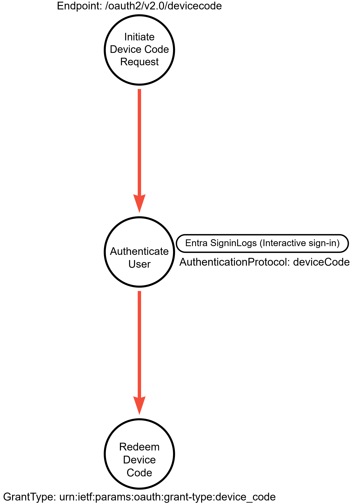
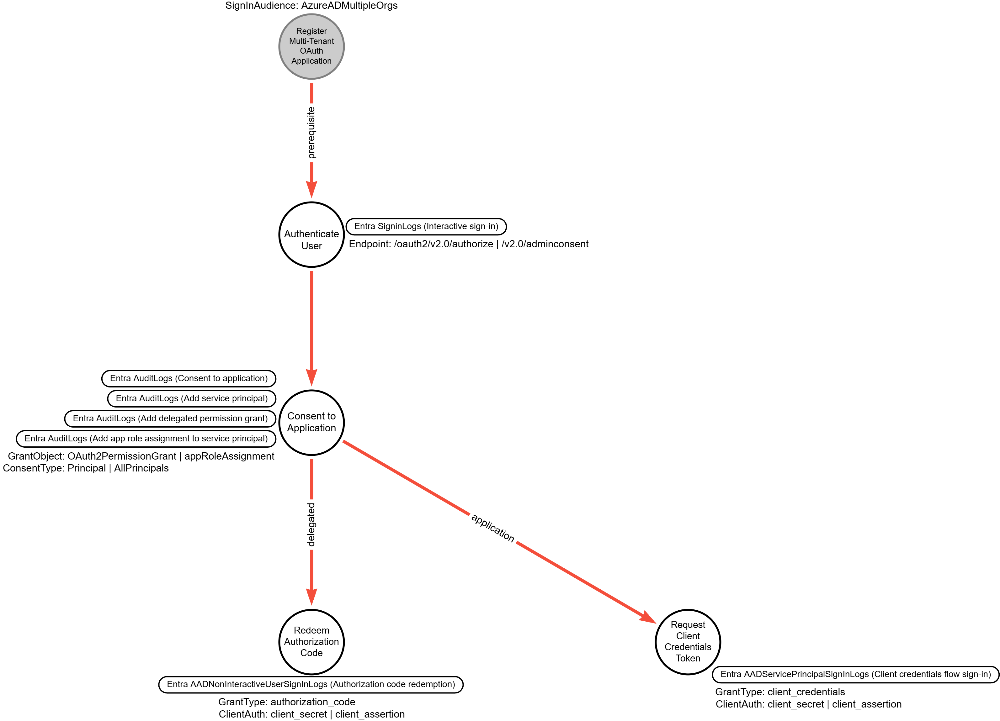
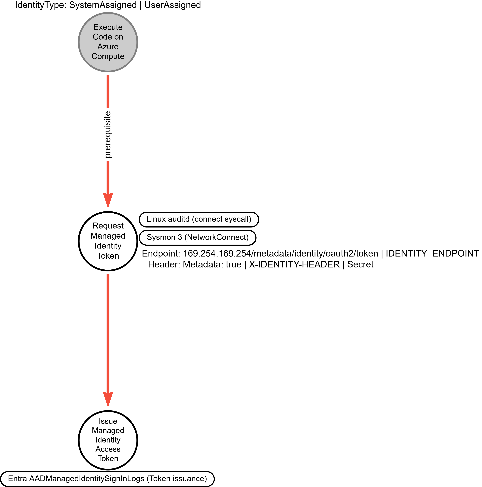
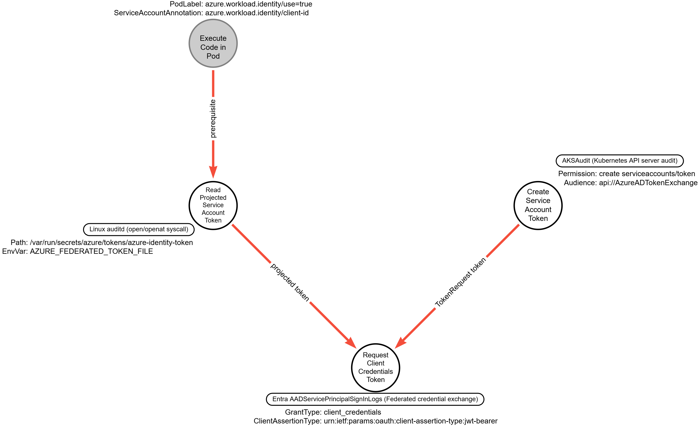

# Steal Application Access Token (Microsoft Entra ID)

## Metadata

| Key          | Value                                                  |
|--------------|--------------------------------------------------------|
| ID           | TRR0000                                                |
| External IDs | [AZT203], [AZT601], [T1528]                            |
| Tactics      | Credential Access                                      |
| Platforms    | Identity Provider, Containers, IaaS, Office Suite, SaaS|
| Contributors | John McGuinness                                        |

### Scope Statement

This TRR covers OAuth access-token acquisition on Microsoft Entra ID where an
adversary causes a legitimate Entra ID OAuth flow to issue tokens to
attacker-controlled infrastructure, or extracts a token issued to an
Entra-attached managed identity or federated workload identity on a compromised
Azure compute or AKS resource.

The pipeline ends at the adversary's first receipt of the access or refresh
token; later use of the token is [T1550.001]. This TRR treats theft of an
application secret or certificate from disk, a repository, or a key vault as
[T1552], a read of a client's on-disk token cache as [T1552.001], and issuance
with a stolen secret or certificate on a legitimately consented principal as
[T1078.004], not Procedure B. Authorization-code phishing against a Microsoft
first-party `client_id` is TRR0034. Azure Arc-enabled servers, Logic Apps
workflows, federated identity credentials trusting issuers outside Azure
compute, and authentication transfer are not modeled.

## Technique Overview

An adversary obtains a Microsoft Entra ID access token or refresh token issued
on behalf of a user, service principal, managed identity, or federated workload
identity, and holds it outside the client the token was issued to. Entra ID
issues bearer tokens, which any party in possession can use without
demonstrating possession of a cryptographic key. Because the authentication
requirements were met when the token was issued, a replayed token grants the
adversary access to organizational resources even where the user satisfied
multifactor authentication.

## Technical Background

### Microsoft Identity Platform Endpoints

Example v2.0 authorization and token endpoints are
`https://login.microsoftonline.com/{tenant}/oauth2/v2.0/authorize` and
`https://login.microsoftonline.com/{tenant}/oauth2/v2.0/token`.[^1] Interactive
user flows obtain authorization at `/authorize` and redeem at `/token`. The
device code flow posts to `/oauth2/v2.0/devicecode` and then polls `/token`.[^2]
Client credentials and federated-credential exchange also redeem at
`/oauth2/v2.0/token`.[^3] The documented managed identity token requests go to
the IMDS address, a `localhost` service, or the URL in `IDENTITY_ENDPOINT`, as
described in [The Instance Metadata Service]. AKS workload identity exchanges a
projected Kubernetes service account token at the Entra token endpoint rather
than through IMDS.[^4]

### Device Authorization Grant Internals

In the device authorization grant the device requesting the authorization is not
the same as the device from which the user grants access.[^5] Entra ID has no
reliable way to verify that the person who enters the code is signing in from
the device that generated it.[^6] The client posts `client_id` and `scope` to
`/oauth2/v2.0/devicecode` and receives a `device_code`, a `user_code` for the
user to enter at the verification URI, and the code's lifetime and polling
interval.[^2] An example verification URI is
`https://microsoft.com/devicelogin`.[^7] While the user authenticates there, the
client polls `/oauth2/v2.0/token` with
`grant_type=urn:ietf:params:oauth:grant-type:device_code` and the `device_code`;
once the user signs in, the device obtains access tokens and, if
`offline_access` was in the original `scope`, a refresh token. The flow is
available only for public client applications,[^7] and since June 2021 it
includes a prompt that validates the user is signing into the app they
expect.[^8]

### Authorization Code Flow Internals

The authorization code flow is a two-leg exchange.[^9] An `/authorize` request
carrying `client_id`, `scope`, and a registered `redirect_uri` returns a code to
that URI once the user authenticates and consents; a `/token` request with
`grant_type=authorization_code`, the code, and the same `redirect_uri` redeems
it. Confidential web apps authenticate the redemption with a `client_secret` or
a `client_assertion` JWT signed with a registered certificate. The response
carries an access token and, only if `offline_access` was requested, a refresh
token. A code may be used to redeem an access token only once,[^7] and RFC 6749
recommends a maximum code lifetime of 10 minutes.[^10]

### Client Credentials and Federated Credential Exchange

Service-principal token issuance is a POST to `/oauth2/v2.0/token` with
`grant_type=client_credentials`.[^3] The client authenticates with a shared
secret or with a `client_assertion` JWT. It creates and signs the assertion
itself with the certificate registered for it, or it gets the assertion from
another identity provider, such as Kubernetes, whose specifics are registered on
the application as a federated identity credential. The assertion cases set
`client_assertion_type` to
`urn:ietf:params:oauth:client-assertion-type:jwt-bearer`. The `/.default` scope
value tells the platform to issue a token for the direct application permissions
configured for the resource, and refresh tokens are never granted with this
flow. Permissions are granted directly to the application by an administrator,
and no user is involved. AKS workload identity presents the kubelet-projected
service-account JWT as the `client_assertion`.[^4] The federated identity
credential's `issuer`, `subject`, and `audience` values must case-sensitively
match the corresponding claims in the token;[^11] when the checks pass, the
platform issues an access token to the external workload.

### The Instance Metadata Service

The Instance Metadata Service (IMDS) is a REST API at the non-routable address
`169.254.169.254`, accessible only from within a running virtual machine
instance,[^12] and its managed identity token endpoint is
`http://169.254.169.254/metadata/identity/oauth2/token`.[^13] The security
boundary of a managed identity is the resource where it is used: all code and
scripts running on a virtual machine can request and retrieve tokens for any
managed identity available on it.[^13] A request must carry the header
`Metadata: true`, a mitigation against server-side request forgery, and names
the target resource's App ID URI in the `resource` query parameter, which also
appears in the issued token's `aud` claim. The token is based on the managed
identity's service principal[^13] and represents the application that accesses
the resource, not any specific user.[^14] The managed identities subsystem
caches tokens, so a call to Entra ID results only when no token is in the cache
or the cached token is expired.

App Service, Azure Functions, and Container Apps expose an internally accessible
token endpoint whose URL is in `IDENTITY_ENDPOINT`. The caller sends the
platform-rotated `IDENTITY_HEADER` value as the `X-IDENTITY-HEADER` header on an
HTTP GET to that URL.[^14][^15][^16] Azure Automation's runbook samples send the
same header to the URL in `IDENTITY_ENDPOINT`.[^17] Service Fabric exposes an
HTTPS `localhost` token service that takes a `Secret` header.[^18] The Container
Instances sample token request goes to the IMDS address with the `Metadata`
header, or, for Windows container instances, to `IDENTITY_ENDPOINT` with
`IDENTITY_HEADER`.[^19] In an AKS cluster the IMDS endpoint is reachable from
all pods by default; when IMDS restriction is enabled, pods that are not on the
host network cannot acquire managed identity tokens from it.[^20]

### Access Tokens

An Entra ID access token is a signed JSON web token[^21] whose claims are
defined in the claims reference,[^22] and a standard OAuth2 token contains no
certificate binding information.[^23] An access token receives a random default
lifetime between 60 and 90 minutes, or up to 28 hours when both the client and
the resource support Continuous Access Evaluation.[^24][^25] A refresh token's
Max Inactive Time is 90 days and its Max Age is until-revoked;[^24] one sent to
a redirect URI registered as `spa` expires after 24 hours.[^9] The user has 15
minutes from the device authorization request to sign in, the default
`expires_in` of a device code.[^2]

### Conditional Access and Device Code Flow

The Conditional Access authentication flows condition explicitly targets device
code flow.[^26] Protocol tracking state is sustained through subsequent
refreshes, so a session that began with device code flow can remain subject to
authentication flows policies on later redemptions. Starting July 1, 2026, all
new Microsoft Entra tenants block device code flow as part of security
defaults.[^27] The require-managed-device grant control and device state
conditions are not supported with device code flow, because the device
performing authentication cannot provide its device state to the device that is
providing a code.[^28]

### OAuth Consent Framework

Delegated permissions let an application act on a user's behalf and appear in
the `scp` claim; application permissions, also known as app roles, are used in
the app-only scenario without a signed-in user and are carried in the `roles`
claim.[^29][^30] Users can consent to delegated permissions for their own data
and administrators for all users;[^29] app-only permissions always require a
tenant administrator's consent.[^31] For Microsoft Graph the result of consent
is an `OAuth2PermissionGrant` for delegated permissions or an
`appRoleAssignment` for application permissions,[^29] and an
`OAuth2PermissionGrant` carries `consentType` `Principal` (one user) or
`AllPrincipals` (all users, grantable by an administrator).[^32] Application
permissions can be granted through a consent experience.[^33]

Tenant user-consent settings offer three options: no user consent; consent only
to applications from verified publishers or the organization, and only for
permissions the administrator selects; or consent to any application for any
permission that does not require admin consent.[^34] Risk-based step-up consent
is enabled by default and changes behavior only when user consent is enabled;
with it, users cannot consent to most newly registered multitenant apps that are
not publisher verified.[^35][^36] The Microsoft managed consent policy, the
default for a new tenant, lets end users consent to any user-consentable
delegated permission except a Microsoft-maintained list of Microsoft Graph and
Exchange Online scopes.[^37]

Granting tenant-wide admin consent requires signing in as a user authorized to
consent on behalf of the organization.[^38] Privileged Role Administrator
qualifies for any permission on any API; Cloud Application Administrator, AI
Administrator, and Application Administrator qualify for any permission except
Microsoft Graph app roles; a custom directory role that includes the permission
to grant permissions to applications also qualifies.[^38][^39] The admin consent
endpoint `https://login.microsoftonline.com/{tenant}/v2.0/adminconsent` requires
a tenant administrator to sign in to complete the request, application
permissions are requested through the `/.default` scope value, and the
documented success redirect carries `admin_consent=True`, `tenant`, `scope`, and
`state`.[^40]

### Telemetry Surfaces

Entra ID sign-in logs have four types: interactive user, non-interactive user,
service principal, and managed identity sign-ins.[^41] In an interactive sign-in
the user provides an authentication factor to Entra ID.[^42] A non-interactive
sign-in is done on behalf of a user by a client app or OS component without the
user providing a factor. Examples are a client app using a refresh token to get
an access token and a client using an authorization code to get an access token
and refresh token.[^43] A service principal sign-in involves no user: the app
provides its own credential, such as a certificate or app secret, as an
application using a client secret in the client credentials flow does.[^44]
Managed identity sign-ins are performed by resources whose secrets Azure
manages.[^45] In a Log Analytics workspace the four types are the `SigninLogs`,
`AADNonInteractiveUserSignInLogs`, `AADServicePrincipalSignInLogs`, and
`AADManagedIdentitySignInLogs` tables.[^46][^47][^48][^49][^50]

`AuthenticationProtocol` lists the protocol type or grant type used in the
authentication, and `deviceCode` is among its values.[^46]
`OriginalTransferMethod` carries the transfer method used to initiate a session
throughout all subsequent requests;[^46] the Graph `originalTransferMethod`
value for a session begun with device code flow is `deviceCodeFlow`.[^51] For
non-interactive sign-ins performed by confidential clients, the logged
`IPAddress` is the original IP used for the original token issuance, not the
source of the refresh request.[^43]

`AuditLogs` is the Microsoft Entra audit log, which captures changes to
applications, groups, users, and licenses, with the activity in
`ActivityDisplayName`.[^52][^47] The Core Directory activity reference lists,
under category `ApplicationManagement`, the activities `Add app role assignment
to service principal`, `Add delegated permission grant`, `Add service
principal`, and `Consent to application`.[^53] `Consent to application`
corresponds to a user granting consent, `Add delegated permission grant` to
granting delegated access, and `Add app role assignment to service principal` to
granting app-only access.[^54]

On the host, an outbound connection from the resource is observable as a Linux
auditd `SYSCALL` record, which a syscall rule naming `connect` starts when a
program makes that call.[^55][^56] It is also observable as Sysmon event ID 3
(NetworkConnect), which logs TCP and UDP connections linked to a process, is
disabled by default, and is defined in the shared event manifest for Windows and
Linux.[^57][^58] A file read in a pod is observable as an auditd record under a
watch rule (`-w path`) or a syscall rule with `-F path`.[^55] An audit event
contains a `PATH` record for every path passed to the system call,[^56] and
since glibc 2.26 the `open()` wrapper issues the `openat()` system call.[^59]
`AKSAudit` contains all Kubernetes API server audit logs, requires diagnostic
settings, and carries the request's `Verb` and `ObjectRef`.[^60][^61][^62] In
the Kubernetes authorization model an HTTP `POST` maps to the `create`
verb.[^63]

## Procedures

| ID | Title | Tactic |
|---|---|---|
| TRR0000.AZR.A | Device Code Phishing | Credential Access |
| TRR0000.AZR.B | Multi-Tenant Illicit Consent Grant | Credential Access |
| TRR0000.AZR.C | Managed Identity Token Retrieval | Credential Access |
| TRR0000.AZR.D | AKS Workload Identity Token Theft | Credential Access |

### Procedure A: Device Code Phishing (TRR0000.AZR.A)

This procedure covers the device authorization grant initiated on a device in
the adversary's possession, with the victim granting access from another device;
the request and response shapes are stated in [Device Authorization Grant
Internals]. The adversary generates a legitimate device code request at
`/oauth2/v2.0/devicecode` and tricks the target into entering the `user_code` at
a legitimate Microsoft sign-in page.[^64] The victim's authentication at the
verification page authenticates the adversary's session,[^65] and the
adversary's client, polling `/oauth2/v2.0/token` with the device-code grant
type, receives the resulting access and refresh tokens[^64] through a back
channel.[^7]

The victim's device-code authentication is an `Entra SigninLogs (Interactive
sign-in)` row with `AuthenticationProtocol` = `deviceCode`. That placement
follows from the interactive sign-in definition and the `deviceCode` value in
[Telemetry Surfaces], and from device code flow events in the sign-in logs being
tied to the authentication protocol property.[^26] Whether the device code
request is logged, and whether the redemption at `/oauth2/v2.0/token` writes its
own `AADNonInteractiveUserSignInLogs` row, is not documented by Microsoft, so
neither node carries a label.

### Procedure B: Multi-Tenant Illicit Consent Grant (TRR0000.AZR.B)

This procedure covers consent in the victim tenant to an application the
adversary registered elsewhere. Its two branches end in different token
issuances: a delegated branch that redeems an authorization code, and an
application branch that issues a client-credentials token to the consented
application's service principal. The consent settings, roles, and endpoint are
stated in [OAuth Consent Framework], and the request shapes in [Authorization
Code Flow Internals] and [Client Credentials and Federated Credential Exchange].

The prerequisite, drawn gray, is an application registered with the sign-in
audience `AzureADMultipleOrgs`, which admits work or school accounts from any
organization's tenant.[^66] An application object is the global representation
for use across all tenants and its service principal is the local representation
in a specific tenant, with changes to the object reflected only in the home
tenant.[^67] The victim tenant therefore receives its first object for the
application at consent. The registration is drawn gray because it happens in the
application's home tenant, not the victim tenant.

On the delegated branch the victim authenticates at `/oauth2/v2.0/authorize`.
When a user from a different tenant signs in to the application for the first
time, Entra ID asks the user to consent to the requested permissions.[^31] If
the user consents, a service principal for the application is created in the
user's tenant and a delegation recording the consent is created in the
directory.[^31] The platform then returns the authorization code to the
registered `redirect_uri`, and the adversary redeems it at `/oauth2/v2.0/token`
with the application's own credential. Whether the victim may consent at all
depends on the tenant settings stated in [OAuth Consent Framework]. The consent
prompt appears when no previous record of user or admin consent for the required
permissions exists.[^34] It follows that a run against a grant created earlier
can pass through the sign-in and the code redemption with that earlier consent
as its prerequisite. Whether the consent audit rows are written again on such a
run is not documented.

On the application branch a tenant administrator signs in at the admin consent
endpoint, and for Microsoft Graph permissions the consent results in an
`appRoleAssignment`. The documented success redirect in [OAuth Consent
Framework] lists no `code` parameter, and the application proceeds directly to a
`/token` request with the client-credentials grant and its own credential.[^3]

The victim's interactive sign-in is an `Entra SigninLogs (Interactive sign-in)`
row whose `AppId` column identifies the application. On the delegated branch the
consent produces `Entra AuditLogs (Consent to application)`, `Entra AuditLogs
(Add service principal)`, and `Entra AuditLogs (Add delegated permission grant)`
rows. The `Add service principal` row follows from consent creating the service
principal in the victim tenant. On the application branch the admin consent run
carries the label `Entra AuditLogs (Add app role assignment to service
principal)`, the app-only access activity in [Telemetry Surfaces]. That
placement follows from application permissions being grantable through a consent
experience, as stated in [OAuth Consent Framework]; no Microsoft page shows the
row for an admin consent run. The code redemption is an `Entra
AADNonInteractiveUserSignInLogs (Authorization code redemption)` row, the
non-interactive sign-in example in [Telemetry Surfaces]. The client-credentials
issuance is an `Entra AADServicePrincipalSignInLogs (Client credentials flow
sign-in)` row carrying `ClientCredentialType`, `ServicePrincipalId`, and
`AppId`. That the row lands in the victim tenant's log follows from consent
creating the service principal there and the token request naming that tenant in
its path.

### Procedure C: Managed Identity Token Retrieval (TRR0000.AZR.C)

This procedure covers a token request from code the adversary runs on an Azure
compute resource with an attached managed identity, against the managed identity
token endpoint; the endpoint, header, and caching facts are stated in [The
Instance Metadata Service]. The token represents the application and not any
specific user, and none of the documented token requests in [The Instance
Metadata Service] shows an authorization-endpoint step; that no user
authentication or consent step precedes the request follows from those
statements.

The prerequisite, drawn gray, is code execution on the resource with a
system-assigned or user-assigned identity: an Azure VM, App Service, Function
App, Container Instance, AKS node, Container App, Service Fabric, or Automation
Account. Code execution on the resource is the access vector, outside the
technique's observable boundary, and any record the vector produces belongs to
the vector's own technique. From the resource the adversary issues the token
request to the managed identity token endpoint, using the endpoint and header of
that host, and receives a bearer access token. On AKS, a pod without the
`azure.workload.identity/use` label is not mutated by the workload identity
admission webhook.[^4] A credential chain that falls through to managed
identity[^68] then calls the node's IMDS and obtains a token for an identity
attached to the node. That path follows from those statements and the AKS IMDS
default in [The Instance Metadata Service], and it runs through this procedure
rather than Procedure D. The kubelet identity's default permissions are
None.[^69]

The request is observable as `Linux auditd (connect syscall)` and `Sysmon 3
(NetworkConnect)` records for the connection to the token endpoint address. The
issuance is an `Entra AADManagedIdentitySignInLogs (Token issuance)` row
carrying `ServicePrincipalId`, `ResourceIdentity`, `ResourceDisplayName`, and
`ManagedServiceIdentity`. That on an Azure VM a request served from the
subsystem cache writes no row follows from the cache behavior in [The Instance
Metadata Service] and the sign-in table in [Telemetry Surfaces]. The adversary's
request to the IMDS endpoint itself has no documented Entra record.

### Procedure D: AKS Workload Identity Token Theft (TRR0000.AZR.D)

This procedure covers acquisition of a Kubernetes service account JWT that a
federated identity credential trusts, followed by its exchange at the Entra
token endpoint for an access token issued to the federated application. The
exchange request and the credential matching rules are stated in [Client
Credentials and Federated Credential Exchange], and the two branches differ in
how the assertion is obtained.

On the projected-token branch the prerequisite, drawn gray for the reason given
in Procedure C, is code execution in a pod of an AKS cluster configured for
Microsoft Entra Workload ID. Only pods carrying the label
`azure.workload.identity/use: "true"` are mutated by the admission webhook to
inject the Azure environment variables and the projected service account token
volume, and the service account carries the `azure.workload.identity/client-id`
annotation naming the Entra application.[^4] The adversary reads the projected
token from the file named by `AZURE_FEDERATED_TOKEN_FILE`,
`/var/run/secrets/azure/tokens/azure-identity-token` in the documented example,
a mount path that is an implementation detail of the webhook and can change.[^4]
The token is a signed JWT[^70] that Kubernetes refreshes in place before it
expires.[^4] The read is observable as `Linux auditd (open/openat syscall)`
under a rule keyed on the path. `/proc/<pid>/environ` holds the initial
environment set at `execve`.[^71] That a read of it yields the token file path
and not the token follows from that content and from
`AZURE_FEDERATED_TOKEN_FILE` holding a path. `/proc/<pid>/mem` gives access to a
process's memory pages under a ptrace access-mode check.[^72] The `environ` and
`mem` reads open a procfs path rather than the token path; it follows that a
path-keyed audit rule covers the token-file read and not the memory read.

On the TokenRequest branch the adversary mints the assertion instead of reading
it. The operation requires `create` on `serviceaccounts/token`, the right that
lets users create TokenRequests to issue tokens for existing service
accounts,[^73] carried as the operation's `Permission`. The TokenRequest
subresource of a ServiceAccount, a `POST` to
`/api/v1/namespaces/{namespace}/serviceaccounts/{name}/token`, issues a
time-bound token for that service account with the audiences the caller
requests.[^74][^75] Direct Entra workload identity federation requires a token
with the audience `api://AzureADTokenExchange`; when identity bindings are
enabled the identity binding webhook sets the default projected token's audience
to `api://AKSIdentityBinding` instead.[^4] The federated identity credential for
a service account names the subject `system:serviceaccount:<namespace>:<name>`
and lists the audiences that may appear in the token, with
`api://AzureADTokenExchange` as the recommended value.[^76] The credential
matches on the issuer, subject, and audience named in [Client Credentials and
Federated Credential Exchange], and a TokenRequest for the same service account
carries that subject and the requested audience. That Entra ID accepts a minted
token follows from that match; the exchange is documented only for the projected
token. The request is observable as an `AKSAudit (Kubernetes API server audit)`
row. That the row carries `Verb` `create` and `ObjectRef` resource
`serviceaccounts`, subresource `token` follows from the POST-to-create mapping
and the audit event fields in [Telemetry Surfaces]. The kubelet obtains
projected service account tokens through the TokenRequest API,[^74] so its own
requests would carry the same verb and object reference.

Either assertion is presented at `/oauth2/v2.0/token` for the federated
application. An exchange whose federated identity credential is on an
application registration is an `Entra AADServicePrincipalSignInLogs (Federated
credential exchange)` row identified by `ClientCredentialType` and
`FederatedCredentialId`. `AADManagedIdentitySignInLogs` also carries
`FederatedCredentialId`, and the documented AKS setup federates a user-assigned
managed identity,[^77] so which table records an exchange whose credential is on
a user-assigned managed identity is not stated. The
`AADServicePrincipalSignInLogs` `IPAddress` column is the address of the client
used to sign in.[^49] By default AKS egresses through an AKS-assigned Standard
Load Balancer public IP, and the NAT gateway outbound types egress through Azure
NAT Gateway.[^78] That the row records the cluster's egress address rather than
the pod's follows from the column definition and the egress configuration. The
credential's `subject` must match the token's `sub` claim,[^79] and it follows
that a federated identity credential whose subject names a different namespace
or service account authorizes that account's pods instead.

## Available Emulation Tests

| ID      | Link                                                        |
|---------|-------------------------------------------------------------|
| T1528-1 | [Atomic Test 1 - Functions Code Injection via Blob Upload]  |
| T1528-2 | [Atomic Test 2 - Functions Code Injection via File Share]   |

## References

- [MITRE ATT&CK T1528]
- [Azure Threat Research Matrix AZT203]
- [Azure Threat Research Matrix AZT601]
- [RFC 6750 OAuth 2.0 Bearer Token Usage]
- [Microsoft Token Theft Playbook]
- [RFC 8628 OAuth 2.0 Device Authorization Grant]
- [Microsoft Identity Platform OAuth 2.0 Device Authorization Grant]
- [Microsoft Identity Platform OAuth 2.0 Authorization Code Flow]
- [Microsoft Identity Platform Client Credentials Flow]
- [Microsoft Identity Platform Admin Consent Endpoint]
- [Azure Instance Metadata Service]
- [Use Managed Identities on an Azure VM to Acquire Access Tokens]
- [Use Microsoft Entra Workload ID on AKS]
- [Microsoft Identity Platform Workload Identity Federation]
- [Kubernetes TokenRequest API Reference]
- [Azure Monitor SigninLogs Table]
- [Azure Monitor AADNonInteractiveUserSignInLogs Table]
- [Azure Monitor AADServicePrincipalSignInLogs Table]
- [Azure Monitor AADManagedIdentitySignInLogs Table]
- [Azure Monitor AuditLogs Table]
- [Azure Monitor AKSAudit Table]
- [Microsoft Entra Audit Activity Reference]
- [Sysmon]
- [Linux auditctl Manual Page]
- [Microsoft Security Blog - Storm-2372 Device Code Phishing]
- [Microsoft Security Blog - AI-Enabled Device Code Phishing 2026]
- [Microsoft Security Blog - CaptiveCrunch]
- [Huntress - Railway PaaS M365 Token Replay Campaign]
- [Sekoia - EvilTokens Device Code Phishing Part 1]
- [Proofpoint - Phishing for Device Code Authorization Account Takeover]
- [Atomic Red Team T1528]

[T1078.004]: https://attack.mitre.org/techniques/T1078/004/
[T1528]: https://attack.mitre.org/techniques/T1528/
[T1550.001]: https://attack.mitre.org/techniques/T1550/001/
[T1552]: https://attack.mitre.org/techniques/T1552/
[T1552.001]: https://attack.mitre.org/techniques/T1552/001/
[AZT203]: https://microsoft.github.io/Azure-Threat-Research-Matrix/InitialAccess/AZT203/AZT203/
[AZT601]: https://microsoft.github.io/Azure-Threat-Research-Matrix/CredentialAccess/AZT601/AZT601/

[Device Authorization Grant Internals]: #device-authorization-grant-internals
[Authorization Code Flow Internals]: #authorization-code-flow-internals
[Client Credentials and Federated Credential Exchange]: #client-credentials-and-federated-credential-exchange
[The Instance Metadata Service]: #the-instance-metadata-service
[OAuth Consent Framework]: #oauth-consent-framework
[Telemetry Surfaces]: #telemetry-surfaces

[MITRE ATT&CK T1528]: https://attack.mitre.org/techniques/T1528/
[Azure Threat Research Matrix AZT203]: https://microsoft.github.io/Azure-Threat-Research-Matrix/InitialAccess/AZT203/AZT203/
[Azure Threat Research Matrix AZT601]: https://microsoft.github.io/Azure-Threat-Research-Matrix/CredentialAccess/AZT601/AZT601/
[RFC 6750 OAuth 2.0 Bearer Token Usage]: https://datatracker.ietf.org/doc/html/rfc6750
[Microsoft Token Theft Playbook]: https://learn.microsoft.com/en-us/security/operations/token-theft-playbook
[RFC 8628 OAuth 2.0 Device Authorization Grant]: https://datatracker.ietf.org/doc/html/rfc8628
[Microsoft Identity Platform OAuth 2.0 Device Authorization Grant]: https://learn.microsoft.com/en-us/entra/identity-platform/v2-oauth2-device-code
[Microsoft Identity Platform OAuth 2.0 Authorization Code Flow]: https://learn.microsoft.com/en-us/entra/identity-platform/v2-oauth2-auth-code-flow
[Microsoft Identity Platform Client Credentials Flow]: https://learn.microsoft.com/en-us/entra/identity-platform/v2-oauth2-client-creds-grant-flow
[Microsoft Identity Platform Admin Consent Endpoint]: https://learn.microsoft.com/en-us/entra/identity-platform/v2-admin-consent
[Azure Instance Metadata Service]: https://learn.microsoft.com/en-us/azure/virtual-machines/instance-metadata-service
[Use Managed Identities on an Azure VM to Acquire Access Tokens]: https://learn.microsoft.com/en-us/entra/identity/managed-identities-azure-resources/how-to-use-vm-token
[Use Microsoft Entra Workload ID on AKS]: https://learn.microsoft.com/en-us/azure/aks/workload-identity-overview
[Microsoft Identity Platform Workload Identity Federation]: https://learn.microsoft.com/en-us/entra/workload-id/workload-identity-federation
[Kubernetes TokenRequest API Reference]: https://raw.githubusercontent.com/kubernetes/website/release-1.34/content/en/docs/reference/kubernetes-api/authentication-resources/token-request-v1.md
[Azure Monitor SigninLogs Table]: https://learn.microsoft.com/en-us/azure/azure-monitor/reference/tables/signinlogs
[Azure Monitor AADNonInteractiveUserSignInLogs Table]: https://learn.microsoft.com/en-us/azure/azure-monitor/reference/tables/aadnoninteractiveusersigninlogs
[Azure Monitor AADServicePrincipalSignInLogs Table]: https://learn.microsoft.com/en-us/azure/azure-monitor/reference/tables/aadserviceprincipalsigninlogs
[Azure Monitor AADManagedIdentitySignInLogs Table]: https://learn.microsoft.com/en-us/azure/azure-monitor/reference/tables/aadmanagedidentitysigninlogs
[Azure Monitor AuditLogs Table]: https://learn.microsoft.com/en-us/azure/azure-monitor/reference/tables/auditlogs
[Azure Monitor AKSAudit Table]: https://learn.microsoft.com/en-us/azure/azure-monitor/reference/tables/aksaudit
[Microsoft Entra Audit Activity Reference]: https://learn.microsoft.com/entra/identity/monitoring-health/reference-audit-activities
[Sysmon]: https://learn.microsoft.com/en-us/sysinternals/downloads/sysmon
[Linux auditctl Manual Page]: https://man7.org/linux/man-pages/man8/auditctl.8.html
[Microsoft Security Blog - Storm-2372 Device Code Phishing]: https://www.microsoft.com/en-us/security/blog/2025/02/13/storm-2372-conducts-device-code-phishing-campaign/
[Microsoft Security Blog - AI-Enabled Device Code Phishing 2026]: https://www.microsoft.com/en-us/security/blog/2026/04/06/ai-enabled-device-code-phishing-campaign-april-2026/
[Microsoft Security Blog - CaptiveCrunch]: https://www.microsoft.com/en-us/security/blog/2026/07/31/captivecrunch-midnight-blizzard-targets-travelers-worldwide-for-malware-delivery-and-credential-theft/
[Huntress - Railway PaaS M365 Token Replay Campaign]: https://www.huntress.com/blog/railway-paas-m365-token-replay-campaign
[Sekoia - EvilTokens Device Code Phishing Part 1]: https://www.sekoia.com/blog/new-widespread-eviltokens-kit-device-code-phishing-as-a-service-part-1
[Proofpoint - Phishing for Device Code Authorization Account Takeover]: https://www.proofpoint.com/us/blog/threat-insight/access-granted-phishing-device-code-authorization-account-takeover
[Atomic Red Team T1528]: https://github.com/redcanaryco/atomic-red-team/tree/master/atomics/T1528
[Atomic Test 1 - Functions Code Injection via Blob Upload]: https://github.com/redcanaryco/atomic-red-team/blob/master/atomics/T1528/T1528.md#atomic-test-1-azure---functions-code-upload---functions-code-injection-via-blob-upload
[Atomic Test 2 - Functions Code Injection via File Share]: https://github.com/redcanaryco/atomic-red-team/blob/master/atomics/T1528/T1528.md#atomic-test-2-azure---functions-code-upload---functions-code-injection-via-file-share-modification-to-retrieve-the-functions-identity-access-token

[^1]: [Microsoft Identity Platform OAuth 2.0 and OpenID Connect Protocols](https://learn.microsoft.com/en-us/entra/identity-platform/v2-protocols)
[^2]: [Microsoft Identity Platform OAuth 2.0 Device Authorization Grant](https://learn.microsoft.com/en-us/entra/identity-platform/v2-oauth2-device-code)
[^3]: [Microsoft Identity Platform Client Credentials Flow](https://learn.microsoft.com/en-us/entra/identity-platform/v2-oauth2-client-creds-grant-flow)
[^4]: [Use Microsoft Entra Workload ID on AKS](https://learn.microsoft.com/en-us/azure/aks/workload-identity-overview)
[^5]: [RFC 8628 OAuth 2.0 Device Authorization Grant](https://datatracker.ietf.org/doc/html/rfc8628)
[^6]: [Dynamics 365 Warehouse Management App User-Based Authentication](https://learn.microsoft.com/dynamics365/supply-chain/warehousing/warehouse-app-authenticate-user-based)
[^7]: [MSAL Authentication Flows](https://learn.microsoft.com/entra/identity-platform/msal-authentication-flows)
[^8]: [Microsoft Identity Platform Breaking Changes Reference](https://learn.microsoft.com/entra/identity-platform/reference-breaking-changes)
[^9]: [Microsoft Identity Platform OAuth 2.0 Authorization Code Flow](https://learn.microsoft.com/en-us/entra/identity-platform/v2-oauth2-auth-code-flow)
[^10]: [RFC 6749 OAuth 2.0 Authorization Framework](https://datatracker.ietf.org/doc/html/rfc6749)
[^11]: [Microsoft Identity Platform Workload Identity Federation](https://learn.microsoft.com/en-us/entra/workload-id/workload-identity-federation)
[^12]: [Azure Instance Metadata Service](https://learn.microsoft.com/en-us/azure/virtual-machines/instance-metadata-service)
[^13]: [Use Managed Identities on an Azure VM to Acquire Access Tokens](https://learn.microsoft.com/en-us/entra/identity/managed-identities-azure-resources/how-to-use-vm-token)
[^14]: [App Service Managed Identity Overview](https://learn.microsoft.com/en-us/azure/app-service/overview-managed-identity)
[^15]: [App Service Environment Variables and App Settings Reference](https://learn.microsoft.com/en-us/azure/app-service/reference-app-settings)
[^16]: [Azure Container Apps Managed Identities](https://learn.microsoft.com/en-us/azure/container-apps/managed-identity)
[^17]: [Enable Managed Identity for Azure Automation](https://learn.microsoft.com/en-us/azure/automation/enable-managed-identity-for-automation)
[^18]: [Service Fabric Managed Identity in Application Code](https://learn.microsoft.com/en-us/azure/service-fabric/how-to-managed-identity-service-fabric-app-code)
[^19]: [Azure Container Instances Managed Identity](https://learn.microsoft.com/en-us/azure/container-instances/container-instances-managed-identity)
[^20]: [AKS IMDS Restriction](https://learn.microsoft.com/en-us/azure/aks/imds-restriction)
[^21]: [Microsoft Identity Platform Access Tokens](https://learn.microsoft.com/en-us/entra/identity-platform/access-tokens)
[^22]: [Microsoft Identity Platform Access Token Claims Reference](https://learn.microsoft.com/en-us/entra/identity-platform/access-token-claims-reference)
[^23]: [Microsoft Identity Web Token Binding](https://learn.microsoft.com/entra/msidweb/call-downstream-apis/token-binding)
[^24]: [Microsoft Identity Platform Configurable Token Lifetimes](https://learn.microsoft.com/en-us/entra/identity-platform/configurable-token-lifetimes)
[^25]: [Microsoft Entra Continuous Access Evaluation](https://learn.microsoft.com/en-us/entra/identity/conditional-access/concept-continuous-access-evaluation)
[^26]: [Microsoft Entra Conditional Access Authentication Flows](https://learn.microsoft.com/en-us/entra/identity/conditional-access/concept-authentication-flows)
[^27]: [Microsoft Entra Security Defaults](https://learn.microsoft.com/entra/fundamentals/security-defaults)
[^28]: [Microsoft Entra Conditional Access Grant Controls](https://learn.microsoft.com/entra/identity/conditional-access/concept-conditional-access-grant)
[^29]: [Microsoft Identity Platform Permissions and Consent Overview](https://learn.microsoft.com/entra/identity-platform/permissions-consent-overview)
[^30]: [Microsoft Entra Application and Delegated Permission Access Tokens](https://learn.microsoft.com/troubleshoot/entra/entra-id/app-integration/application-delegated-permission-access-tokens-identity-platform)
[^31]: [Microsoft Identity Platform Convert App to Multitenant](https://learn.microsoft.com/entra/identity-platform/howto-convert-app-to-be-multi-tenant)
[^32]: [Microsoft Graph oAuth2PermissionGrant Resource](https://learn.microsoft.com/graph/api/resources/oauth2permissiongrant?view=graph-rest-1.0)
[^33]: [Microsoft Graph Service Principal App Role Assignment](https://learn.microsoft.com/en-us/graph/api/serviceprincipal-post-approleassignedto?view=graph-rest-1.0)
[^34]: [Microsoft Entra User and Admin Consent Overview](https://learn.microsoft.com/entra/identity/enterprise-apps/user-admin-consent-overview)
[^35]: [Microsoft Identity Platform Publisher Verification Overview](https://learn.microsoft.com/entra/identity-platform/publisher-verification-overview)
[^36]: [Microsoft Entra Risk-Based Step-Up Consent](https://learn.microsoft.com/entra/identity/enterprise-apps/configure-risk-based-step-up-consent)
[^37]: [Microsoft Entra Manage App Consent Policies](https://learn.microsoft.com/entra/identity/enterprise-apps/manage-app-consent-policies)
[^38]: [Microsoft Entra Grant Tenant-Wide Admin Consent](https://learn.microsoft.com/en-us/entra/identity/enterprise-apps/grant-admin-consent)
[^39]: [Microsoft Entra Built-In Roles Reference](https://learn.microsoft.com/en-us/entra/identity/role-based-access-control/permissions-reference)
[^40]: [Microsoft Identity Platform Admin Consent Endpoint](https://learn.microsoft.com/en-us/entra/identity-platform/v2-admin-consent)
[^41]: [Microsoft Entra Sign-In Logs Overview](https://learn.microsoft.com/en-us/entra/identity/monitoring-health/concept-sign-ins)
[^42]: [Microsoft Entra Interactive User Sign-Ins](https://learn.microsoft.com/en-us/entra/identity/monitoring-health/concept-interactive-sign-ins)
[^43]: [Microsoft Entra Non-Interactive User Sign-Ins](https://learn.microsoft.com/en-us/entra/identity/monitoring-health/concept-noninteractive-sign-ins)
[^44]: [Microsoft Entra Service Principal Sign-Ins](https://learn.microsoft.com/en-us/entra/identity/monitoring-health/concept-service-principal-sign-ins)
[^45]: [Microsoft Entra Managed Identity Sign-Ins](https://learn.microsoft.com/en-us/entra/identity/monitoring-health/concept-managed-identity-sign-ins)
[^46]: [Azure Monitor SigninLogs Table](https://learn.microsoft.com/en-us/azure/azure-monitor/reference/tables/signinlogs)
[^47]: [Microsoft Entra Diagnostic Settings Log Options](https://learn.microsoft.com/en-us/entra/identity/monitoring-health/concept-diagnostic-settings-logs-options)
[^48]: [Azure Monitor AADNonInteractiveUserSignInLogs Table](https://learn.microsoft.com/en-us/azure/azure-monitor/reference/tables/aadnoninteractiveusersigninlogs)
[^49]: [Azure Monitor AADServicePrincipalSignInLogs Table](https://learn.microsoft.com/en-us/azure/azure-monitor/reference/tables/aadserviceprincipalsigninlogs)
[^50]: [Azure Monitor AADManagedIdentitySignInLogs Table](https://learn.microsoft.com/en-us/azure/azure-monitor/reference/tables/aadmanagedidentitysigninlogs)
[^51]: [Microsoft Graph signIn Resource](https://learn.microsoft.com/en-us/graph/api/resources/signin?view=graph-rest-beta)
[^52]: [Azure Monitor AuditLogs Table](https://learn.microsoft.com/en-us/azure/azure-monitor/reference/tables/auditlogs)
[^53]: [Microsoft Entra Audit Activity Reference](https://learn.microsoft.com/entra/identity/monitoring-health/reference-audit-activities)
[^54]: [Microsoft Entra Audit Logs for App Permissions](https://learn.microsoft.com/entra/identity/enterprise-apps/app-perms-audit-logs)
[^55]: [Linux auditctl Manual Page](https://man7.org/linux/man-pages/man8/auditctl.8.html)
[^56]: [Red Hat Auditing the System](https://docs.redhat.com/en/documentation/red_hat_enterprise_linux/9/html/security_hardening/auditing-the-system_security-hardening)
[^57]: [Sysmon](https://learn.microsoft.com/en-us/sysinternals/downloads/sysmon)
[^58]: [Sysmon Common Event Manifest](https://raw.githubusercontent.com/microsoft/SysmonCommon/main/manifest.xml)
[^59]: [Linux open Manual Page](https://man7.org/linux/man-pages/man2/open.2.html)
[^60]: [Azure Monitor AKSAudit Table](https://learn.microsoft.com/en-us/azure/azure-monitor/reference/tables/aksaudit)
[^61]: [Kubernetes Auditing](https://kubernetes.io/docs/tasks/debug/debug-cluster/audit/)
[^62]: [Kubernetes Audit API Reference](https://kubernetes.io/docs/reference/config-api/apiserver-audit.v1/)
[^63]: [Kubernetes Authorization Overview](https://kubernetes.io/docs/reference/access-authn-authz/authorization/)
[^64]: [Microsoft Security Blog - Storm-2372 Device Code Phishing](https://www.microsoft.com/en-us/security/blog/2025/02/13/storm-2372-conducts-device-code-phishing-campaign/)
[^65]: [Microsoft Security Blog - CaptiveCrunch](https://www.microsoft.com/en-us/security/blog/2026/07/31/captivecrunch-midnight-blizzard-targets-travelers-worldwide-for-malware-delivery-and-credential-theft/)
[^66]: [Microsoft Identity Platform App Manifest Reference](https://learn.microsoft.com/entra/identity-platform/reference-microsoft-graph-app-manifest)
[^67]: [Microsoft Identity Platform Application and Service Principal Objects](https://learn.microsoft.com/entra/identity-platform/app-objects-and-service-principals)
[^68]: [Azure SDK Credential Chains](https://learn.microsoft.com/en-us/azure/developer/python/sdk/authentication/credential-chains)
[^69]: [AKS Managed Identity Overview](https://learn.microsoft.com/en-us/azure/aks/managed-identity-overview)
[^70]: [Kubernetes Authentication](https://kubernetes.io/docs/reference/access-authn-authz/authentication/)
[^71]: [Linux proc_pid_environ Manual Page](https://man7.org/linux/man-pages/man5/proc_pid_environ.5.html)
[^72]: [Linux proc_pid_mem Manual Page](https://man7.org/linux/man-pages/man5/proc_pid_mem.5.html)
[^73]: [Kubernetes RBAC Good Practices](https://kubernetes.io/docs/concepts/security/rbac-good-practices/)
[^74]: [Kubernetes Service Account Administration](https://kubernetes.io/docs/reference/access-authn-authz/service-accounts-admin/)
[^75]: [Kubernetes TokenRequest API Reference](https://raw.githubusercontent.com/kubernetes/website/release-1.34/content/en/docs/reference/kubernetes-api/authentication-resources/token-request-v1.md)
[^76]: [Microsoft Entra Workload Identity Federation Create Trust](https://learn.microsoft.com/en-us/entra/workload-id/workload-identity-federation-create-trust)
[^77]: [Deploy Microsoft Entra Workload ID on AKS](https://learn.microsoft.com/en-us/azure/aks/workload-identity-deploy-cluster)
[^78]: [Customize Cluster Egress with Outbound Types in AKS](https://learn.microsoft.com/en-us/azure/aks/egress-outboundtype)
[^79]: [Microsoft Entra Workload Identity Federation Considerations](https://learn.microsoft.com/en-us/entra/workload-id/workload-identity-federation-considerations)
