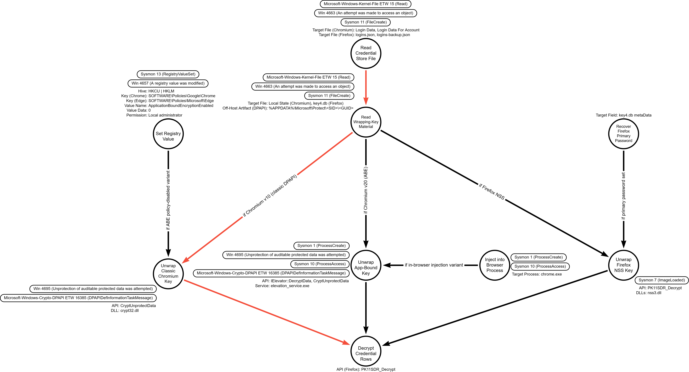
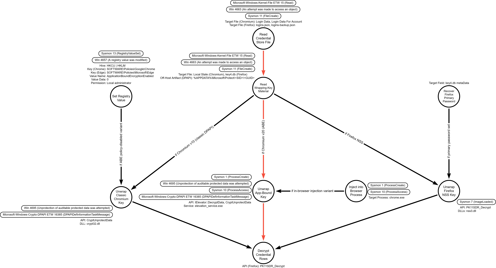
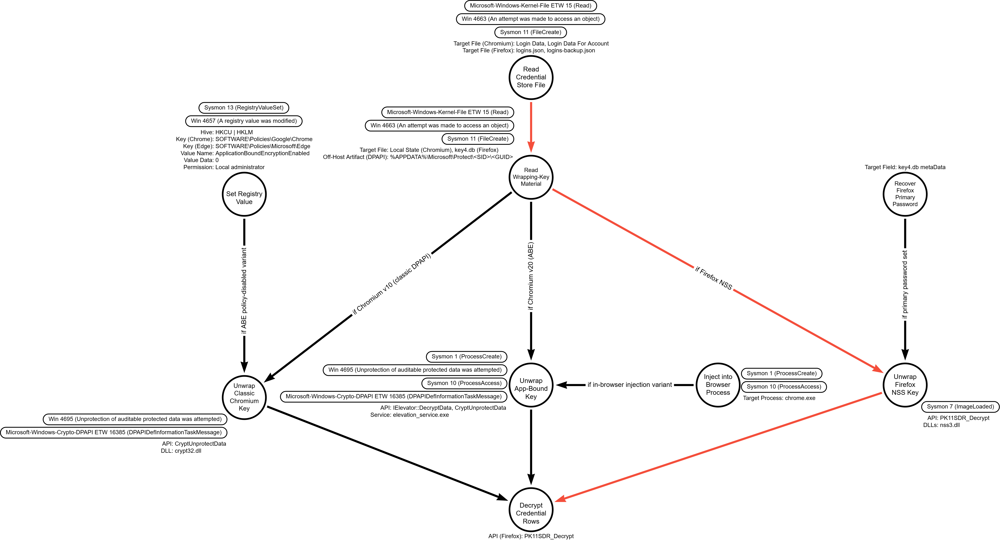

# Credentials from Web Browsers

## Metadata

| Key          | Value                        |
|--------------|------------------------------|
| ID           | TRR0000                      |
| External IDs | [T1555.003]                  |
| Tactics      | Credential Access            |
| Platforms    | Windows                      |
| Contributors |                              |

### Scope Statement

This TRR covers reading and decrypting locally-stored saved usernames and
passwords from Chromium-family browsers and Firefox on Windows, across the
three cryptographic paths those browser families use to protect the stored
credential rows.

Browser session cookies, the first secret type Google planned to migrate to
App-Bound Encryption in Chrome 127, map to T1539 (Steal Web Session
Cookie).[^1][^2] This TRR does not model reading browser process memory,
either to search it for credential patterns, which ATT&CK lists under
T1555.003,[^3] or to read saved passwords the browser has decrypted,[^4]
because neither reads the credential store or unwraps a key. Reading the
unwrapped App-Bound key from browser memory is modeled under [Procedure B].
Opera and Vivaldi are built on the Chromium engine,[^5][^6] and this TRR
folds them, with Edge and Brave, into the Chromium procedures.

## Technique Overview

Web browsers can save website usernames and passwords so they need not be
entered again, and can store them in an encrypted form within a credential
store.[^3] An attacker reads the encrypted store, obtains the key material that
protects it, and runs the browser-specific decryption to recover the plaintext
credentials. Adversaries may then attempt to recycle the recovered credentials
across different systems and accounts to expand access.[^3]

## Technical Background

The three procedures share the two file reads and diverge at the unwrap step,
the cryptographic mechanism that produces the plaintext key.

### Chromium Credential Storage

Google Chrome stores its profiles by default under
`%LOCALAPPDATA%\Google\Chrome\User Data`, each profile a subdirectory of that
user data directory.[^7] Edge's default profile path is
`C:\Users\<Current-user>\AppData\Local\Microsoft\Edge\User Data\Default`,[^8]
and Brave's install configuration sets its company path to `BraveSoftware`;[^9]
this TRR derives from the shared Chromium code that the same profile files sit
under those roots.

`Login Data` is the per-profile password database,[^10] a SQLite database
whose `logins` table carries `origin_url`, `username_value`, and
`password_value` columns.[^11] Chromium's password manager constants define
`Login Data For Account` beside `Login Data` for the account store.[^10]
`password_value` is bound as an encrypted blob, `origin_url` and
`username_value` as plain strings.[^11] Chromium's SQLite wrapper opens a
database in exclusive locking mode by default, an OS-level advisory lock that
does not protect the file from uncooperative processes.[^12] This TRR found
no lock option in the password store's database options[^11] and derives that
`Login Data` keeps that default. It follows from that advisory lock that a
plain file copy or an `esentutl.exe` copy[^13] reaches the file while the
browser runs. A Volume Shadow Copy snapshot duplicates all of the data on the
volume at one instant.[^14]

`Local State` is a file at the User Data root.[^15] Its `os_crypt` object
carries two Base64-encoded fields.[^16] `os_crypt.encrypted_key` holds the
random wrapping key encrypted with DPAPI.[^17] After Base64 decoding, the
buffer begins with the five-byte ASCII marker `DPAPI`,[^18] followed by the
output of `CryptProtectData` on the key, which Chromium calls without
`CRYPTPROTECT_LOCAL_MACHINE`.[^17] It follows from the flag rule in [DPAPI]
that the key is bound to the user's DPAPI context.
`os_crypt.app_bound_encrypted_key` holds the key managed by App-Bound
Encryption: after Base64 decoding the buffer begins with the four-byte
marker `APPB`,[^19] followed by the doubly-wrapped ciphertext the elevation
service returns.[^20]

Each `password_value` blob begins with a three-character version prefix.
`v10` marks data encrypted with the classic key[^17] and `v20` marks data
encrypted with the App-Bound key.[^19] Both keys are 32 bytes, and both
row formats are decrypted with AES-256-GCM.[^17][^16]

### App-Bound Encryption

Google introduced App-Bound Encryption on Windows in Chrome 127, announced in
July 2024.[^1] DPAPI does not protect against malicious applications able to
execute code as the logged-in user.[^1] App-Bound Encryption relies on a
privileged service that encodes the requesting application's identity into the
encrypted data and verifies it when decryption is attempted.[^1] Chromium turned
its new encryption method for saved passwords, OSCrypt Async, on by default for
new passwords and for re-encrypting existing ones in a change first shipped to
Stable in 137.0.7151.44.[^21][^22] With that method on, the password store no
longer requests output compatible with the classic method,[^23] and the
App-Bound provider has been used for encryption by default since M130.[^24] It
follows that on a supported install the rows Chrome 137 and later write by
default carry the `v20` prefix. App-Bound operations are available only on a
system-level install; on a per-user install every call fails.[^25] Support
further requires the default user data directory, local disks for the browser
and that directory, and no disabling policy.[^26] A roaming Chrome or Windows
profile, including an `FSLogix` key, also fails the check,[^26] and the provider
encrypts only at the supported level.[^16]

The service is a Chromium-maintained COM server compiled into the
standalone executable `elevation_service.exe`,[^27] running with system
privileges.[^1] The browser instantiates the elevator CLSID as a COM local
server and calls `IElevator::EncryptData` and `IElevator::DecryptData` on
it.[^26] Brave registers its own elevator CLSID and IID,[^9] and its service
compiles Chromium's `Elevator` implementation, `DecryptData` included.[^28]

The browser generates a random 32-byte key,[^16] and this TRR derives from
the provider's call chain that the key is all it passes to
`EncryptData`.[^26] The service generates `validation_data` from the
calling process, the executable's NT path with the executable name removed
and a final `Temp`, `Application`, or version directory trimmed.[^29][^30]
It wraps that data and the key twice with `CryptProtectData`,[^29] once
inside client impersonation and once in its own SYSTEM context.[^31] On
`DecryptData` the service unprotects the SYSTEM layer, then the user layer,
then validates the caller:[^20] it trims the current caller's executable
path the same way and byte-compares it against the stored
`validation_data`.[^30] A mismatch returns the validation failure without
the key; a match returns the decrypted key.[^20]

Path validation checks that the data is decrypted by an executable whose
NT path matches the one that encrypted it, and is meant only for
executables in trusted paths such as `C:\Program Files`.[^31] The check
compares paths; this TRR found no signature or image-hash check in
`caller_validation.cc`.[^30] From Chrome 148 the browser encrypts the key
by default at a level that also encloses whether the caller runs isolated,
so a process not running isolated cannot decrypt data an isolated process
encrypted.[^32][^33]

The policy value `ApplicationBoundEncryptionEnabled` is a `REG_DWORD` under
`SOFTWARE\Policies\Microsoft\Edge`, where `0` disables it.[^34] Google's
`chrome.reg` policy file saves Chrome's policy keys under
`HKEY_LOCAL_MACHINE`, at `SOFTWARE\Policies\Google\Chrome`,[^35] and this
TRR treats the Chrome value there as the same `REG_DWORD`, with `0`
disabling it. The Edge policy exists from Edge 127 and, enabled or unset,
binds the encryption keys used for local data storage to Microsoft Edge
whenever possible.[^34] On Windows, Edge protects the profile's encryption
key with Chromium's OSCrypt, whose storage area is DPAPI.[^4] Disabling the
Edge policy takes effect after a browser restart;[^34] this TRR treats
Chrome as needing the same restart. New data is then not encrypted with
app-bound encryption, and old data remains accessible.[^36]

> [!NOTE]
>
> In Chrome 137 and later the AES key sits in the DPAPI-decrypted blob after
> a `\x03` flag byte and requires decryption with CNG using a key from a
> Key Storage Provider.[^37]

### DPAPI

The Data Protection API consists of two functions, `CryptProtectData` and
`CryptUnprotectData`,[^38] whose public interfaces are part of
`crypt32.dll`.[^39] It associates data with an individual user, or with the
computer when the caller sets `CRYPTPROTECT_LOCAL_MACHINE`,[^40] and spares the
caller from generating and storing a cryptographic key.[^41] This TRR reads the
DPAPI descriptions it takes from the October 2001 whitepaper on DPAPI in Windows
XP as current.[^39]

DPAPI generates a master key protected by the user's password.[^39] A PKCS #5
password-derived key encrypts it, and the encrypted master key is stored with
its HMAC, salt, and iteration count in a master-key file in the user's profile
directory.[^39] The salt and iteration count are non-secret and are stored
unencrypted, which lets DPAPI decrypt the master key given the user's
password.[^39] The files sit under
`%APPDATA%\Microsoft\Protect\<SID>\<GUID>`.[^42][^43] When the computer is a
domain member, the client also encrypts the master key with the domain
controller's public key and stores that backup copy with the password-protected
one.[^39] Anyone who holds a domain's DPAPI backup keys can decrypt DPAPI data
for any domain user, even after the user's password changes.[^44]

At runtime the DPAPI functions make a local RPC call to the Local Security
Authority; the RPC endpoints call DPAPI private functions, which call back
into CryptoAPI for the decryption in the security context of the
LSA.[^39] `CryptUnprotectData` decrypts with a session key it creates from
the user's logon credentials.[^45] All applications running under the same
user can access any protected data they know about.[^39] It follows that a
same-user call needs only its logon session, unless the data was protected
with optional entropy, which the unprotect call must repeat,[^45] or with a
prompt structure. This TRR reads from the arguments of Chromium's
classic-key unwrap call that it passes no entropy and no prompt
structure.[^18][^45]

### Firefox and NSS

Login storage is delegated to NSS (Network Security Services), which implements
its own PKCS #11 key store and cryptography.[^46] Firefox's package manifest
lists `nss3`, `softokn3`, `freebl3`, and `mozglue` libraries,[^47] which this
TRR reads as `nss3.dll` and three companion `.dll` files in the Firefox install
directory. Profile root directories are by default under
`%APPDATA%\Mozilla\Firefox\Profiles`, where `%APPDATA%` is the roaming
application data folder.[^48][^43] The login store builds the `logins.json` path
inside the profile directory and, when login backups are enabled, a
`logins-backup.json` backup path beside it.[^49] The NSS component takes the
profile directory as its database location and names its key database
`key4.db`.[^50] `logins.json` is a JSON file whose `logins` array holds one
record per saved login with `encryptedUsername` and `encryptedPassword`
fields.[^51] Firefox Base64-encodes the Secret Decoder Ring output it
stores,[^52] and `PK11SDR_Decrypt` DER-decodes its input.[^53]

NSS initializes its SQLite key database on the `nssPrivate` table,[^46]
and this TRR reads `key4.db`, the key database the NSS component names, as
that database; its `metaData` table carries a `password` entry made of a
salt and a value.[^46][^54] NSS encrypts the fixed string `password-check`
as the stored check value and derives its keys from a global salt read from
the database.[^54] This TRR reads the key database's `nssPrivate` table as
holding the encrypted master key.[^46][^55]

NSS turns the password into a key that depends on the global salt and feeds the
salted value to a PKCS #5 password-based encryption function.[^54] Mozilla calls
the password the primary (formerly master) password;[^56] on a profile where
none is set, this TRR derives from a public decryptor's empty default[^55] that
the password input is empty. NSS selects between two schemes by a database
property: the legacy scheme uses SHA1 with 3DES-CBC, and the current scheme uses
SHA-256 with AES-256-CBC, which NSS decrypts as PBES2.[^54] Login entries are
encrypted separately by the Secret Decoder Ring,[^52] whose `PK11SDR_Decrypt`
accepts only the DES3-CBC and AES-CBC mechanisms.[^53]

It follows from the derivation's inputs, the password and the global
salt,[^54] that no Windows user secret enters it. A standalone process
loads `nss3.dll`, initializes NSS on the profile path, and decrypts saved
logins with no prompt when no primary password is set.[^57][^58]
`PK11SDR_Decrypt` authenticates to the NSS internal key slot before it
finds the key its input names.[^53]

### Telemetry

Sysmon's event list holds file creation, creation-time change, stream creation,
deletion, blocking, and executable detection events and a raw disk or volume
read event,[^59] and lists no event for reading a file's contents. Sysmon 11
(FileCreate) logs a file being created or overwritten,[^59] and a copy creates a
new file at the destination,[^60] so it follows that a copy of a credential file
is logged at the destination path. Win 4663 (An attempt was made to access an
object) generates only if the object's SACL has an ACE for the access right
used[^61] and the Audit File System subcategory is configured.[^62] The default
file-system SACLs generate no audit events,[^63] and the subcategory's default
value is 0.[^62] The Windows 10 1803 manifest of the
Microsoft-Windows-Kernel-File provider defines event 15 with symbol `Read` and
keyword `KERNEL_FILE_KEYWORD_READ`,[^64] as does a manifest set,[^65] collected
across Windows 10 versions from 1511 to 26H1.[^66] A controller enables or
disables event tracing in a provider, and the provider defines what being
enabled means;[^67] it follows that Microsoft-Windows-Kernel-File ETW 15 (Read)
reaches only a trace session for which a controller has enabled the provider.
The off-host variant of [Procedure A] reads the DPAPI master-key file, an
ordinary file in the user profile;[^42] this TRR treats its read as subject to
the same sources.

Chromium protects the classic key with `CRYPTPROTECT_AUDIT` and the product name
as data description,[^17][^68] a flag that generates an audit on protect and
unprotect when the description is non-empty.[^40] Win 4695 (Unprotection of
auditable protected data was attempted) generates when `CryptUnprotectData`
unprotects data protected with that flag.[^69] It follows that the classic
unwrap meets the event's generating condition when the Audit DPAPI Activity
subcategory is audited, whose default is off.[^69][^62] Both of the elevation
service's `CryptProtectData` calls pass `CRYPTPROTECT_AUDIT` with a product-name
description,[^29] and its `DecryptData` unprotects both layers with
`CryptUnprotectData`,[^20] so the same derivation applies to the App-Bound
unwrap. This TRR derives that the replication family's own `CryptUnprotectData`
calls, described in [Procedure B], meet the same condition with the attacker's
process as the caller.[^69] A Microsoft-Windows-Crypto-DPAPI manifest defines
event 16385 (`DPAPIDefInformationTaskMessage`) with a `CallerProcessID`
field.[^70] On this TRR's lab host, the registered provider binds that event to
its Debug channel, disabled there. With the channel enabled,
Microsoft-Windows-Crypto-DPAPI ETW 16385 (DPAPIDefInformationTaskMessage) fired
once per `CryptUnprotectData` call and carried the caller's process ID, for the
browser's classic-key unwrap and for each of the elevation service's two
unwraps. With the LSA call in [DPAPI], it follows that when the classic unwrap
runs off-host against a staged master-key file, no DPAPI call reaches the
victim's LSA, and neither DPAPI record above arises on the victim at the unwrap
step.

Chrome's installer registers its elevation service with start type
`SERVICE_DEMAND_START`, which the SCM starts when a process calls
`StartService`.[^71][^72] On this TRR's Windows 11 Pro lab host (Edge 156), `sc
qc` reports the Edge, Chrome, and Brave elevation services as demand-start;
Edge's start type on other desktop installs is not established. The service
process signals exit when the last reference to its COM module is released,
after which the SCM launches a new process for inbound requests.[^73] Sysmon 1
(ProcessCreate) records each newly created process,[^59] so it follows that it
records each start of `elevation_service.exe`, which the exit-and-relaunch
behavior lets occur more than once per boot. The SCM spawns the service process
when it starts a service, if necessary,[^74] so it follows that the parent is
the SCM's process. The hollowing instance and the hardware-breakpoint variant in
[Procedure B] each create the browser process;[^75][^76] it follows that Sysmon
1 (ProcessCreate) also records the browser the attacker's process creates. The
hardware-breakpoint variant attaches with `DebugActiveProcess`,[^76] whose
caller must be able to open the browser for `PROCESS_ALL_ACCESS`.[^77] Sysmon 10
(ProcessAccess) reports a process opening another process;[^59] this TRR places
it on the attacker's process opening `chrome.exe`[^78] or `msedge.exe`[^79] for
the attach. Remote-thread injection into a running browser needs a handle with
the access rights `CreateRemoteThread` requires;[^80] this TRR derives that the
injection obtains that handle by opening the browser process, an open Sysmon 10
(ProcessAccess) records. The injection then creates a thread in the browser,
which Sysmon 8 (CreateRemoteThread) records.[^59] The policy-disable variant
writes a registry value. Sysmon maps registry key and value create operations to
Sysmon 12 (RegistryEvent Object create and delete) and value modifications to
Sysmon 13 (RegistryValueSet), which records the DWORD value written.[^59] On
this TRR's lab host, creating the policy key raised Sysmon 12 and the write that
created the value raised Sysmon 13, with the DWORD data. The variant's write
also produces Win 4657 (A registry value was modified), which generates only if
Set Value auditing is in the key's SACL[^81] and the Audit Registry subcategory
is configured, whose default is off.[^81][^62]

Sysmon 7 (ImageLoaded) logs a module loading into a process, such as the
`nss3.dll` load described in [Firefox and NSS], and is disabled by default.[^59]

## Procedures

| ID            | Title                             | Tactic            |
|---------------|-----------------------------------|-------------------|
| TRR0000.WIN.A | Chromium Classic DPAPI            | Credential Access |
| TRR0000.WIN.B | Chromium App-Bound Encryption     | Credential Access |
| TRR0000.WIN.C | Firefox NSS                       | Credential Access |

### Procedure A: Chromium Classic DPAPI (TRR0000.WIN.A)

This procedure decrypts saved credentials whose `password_value` prefix is
`v10`: rows wrapped by `os_crypt.encrypted_key`.[^17] It unwraps that key with
one user-context `CryptUnprotectData` call on the blob after the `DPAPI` marker
is stripped,[^18] a call any process running as the user can make under the rule
in [DPAPI]. On this TRR's lab host, Opera 139 and Vivaldi 8.3 saved `v10` rows.

A variant reaches the same unwrap offline; it follows from working on copied
files that it makes no `CryptUnprotectData` call on the victim and runs no code
in the user's session. The attacker copies `Local State` and the user's
master-key file and decrypts offline with the user's password or the domain
backup key,[^42][^82] re-deriving the master key as described in [DPAPI], before
unwrapping `os_crypt.encrypted_key`. Roaming profiles are stored on a
server.[^83] From that and the shadow copy in [Chromium Credential Storage],
this TRR derives that the master-key file is reachable without in-session code
from a file server share when the profile roams, or from a snapshot of the
profile volume. Access to the domain backup keys is restricted to domain
administrators by default.[^44]

A client running as the owning user can also have a domain controller decrypt
the master key over RPC without elevated privileges.[^42][^84] A user's master
keys can also be decrypted with the user's NTLM hash, which works remotely.[^84]
On-host, with administrative access, the DPAPI keys of logged-on users are
extracted from memory.[^42] This TRR derives that the owning user's key then
unwraps `os_crypt.encrypted_key` with no `CryptUnprotectData` call, so that no
Win 4695 (Unprotection of auditable protected data was attempted) generates for
that unwrap.

A second variant begins with the registry write described in [App-Bound
Encryption]: setting `ApplicationBoundEncryptionEnabled` to `0` under
`HKEY_LOCAL_MACHINE`, where Edge also stores its Group Policy settings.[^85] A
standard user has write access only under `HKEY_CURRENT_USER`,[^86] which
Chromium's policy loader reads as user scope.[^87] On this TRR's lab host,
Chrome 156 honored the value set there and Edge 156 listed it as applied, and
the `Policies` key in that hive grants write access to Administrators and SYSTEM
only. It follows that the write requires administrative privileges in either
hive on that host. On a host whose management authority is local to the device
or absent,[^88] Chromium's loader blocks the policies whose definitions carry a
`sensitive` flag.[^87][^89][^90][^91] This TRR derives from the policy's
definition, which carries no such flag,[^92] that the loader does not block the
value on an unmanaged host. This TRR derives from the DPAPI key provider's `v10`
data tag[^18] that the rows the browser saves after the restart described in
[App-Bound Encryption] are classic-key rows. The same derivation covers rows
saved while any support condition in [App-Bound Encryption] fails.

#### Detection Data Model

### Procedure B: Chromium App-Bound Encryption (TRR0000.WIN.B)

This procedure decrypts saved credentials whose `password_value` prefix is
`v20`.[^19] It applies where [App-Bound Encryption] places password rows in the
`v20` format. On this TRR's lab host, Chrome 156, Edge 156, and Brave 156 each
saved a new row in that format.

Under the SYSTEM layer described in [App-Bound Encryption], it follows from
DPAPI's per-user association in [DPAPI] that a user-context DPAPI call does
not unwrap the key in `os_crypt.app_bound_encrypted_key`; the operation is
obtaining the unwrapped App-Bound key, by whichever mechanism. The
browser's own mechanism is the `IElevator::DecryptData` call described in
[App-Bound Encryption], with the blob passed after the `APPB` marker is
stripped.[^16]

Three families of mechanisms reach the key. The first satisfies the path check
and ends in a `DecryptData` return. The attacker decodes the payload into
Chrome's Program Files directory so the caller path matches; the documented
instance first acquires local administrator privileges.[^93] Or the attacker
injects code into a Chrome process, launched or already running;[^78][^1] this
TRR treats the call from the injected process as passing the path check. Or the
attacker creates a suspended browser process and calls `DecryptData` from a
payload hollowed into it.[^75] The second family issues no COM call from the
attacker's process. A debugger attached with `DebugActiveProcess` to a browser
process spawned suspended sets a hardware breakpoint after the browser's own
`os_crypt::DecryptAppBoundString` call and reads the key from a register-held
pointer with `ReadProcessMemory`.[^76] This TRR derives from the key being
present after that call that the browser's own `DecryptData` call ran and passed
validation as itself, so the attacker presents no caller path. It follows that
on the second family the `Local State` read is the browser's own. A third family
gains system privileges[^1] and replicates the service's two unwraps, decrypting
the key with the SYSTEM DPAPI, followed by the user DPAPI, as
administrator.[^37] This TRR derives from the two DPAPI contexts in [App-Bound
Encryption] that a process holding the SYSTEM context and the user's token can
make both `CryptUnprotectData` calls itself without calling `DecryptData`. The
Chrome 137 and later CNG step in the note under [App-Bound Encryption] is
outside that derivation.

#### Detection Data Model

### Procedure C: Firefox NSS (TRR0000.WIN.C)

This procedure decrypts saved credentials from Firefox profiles. It reads
`key4.db` and `logins.json` from the profile directory instead of a
Chromium profile's `Local State` and `Login Data`, and its unwrap operation
is obtaining the unwrapped NSS master key, by whichever mechanism.

The browser's own mechanism calls `PK11SDR_Decrypt` in a process that has loaded
`nss3.dll`, as described in [Firefox and NSS]. A variant re-implements the
derivation and ASN.1 decryption in the attacker's own runtime without NSS and
runs it against copied profile files with the primary password as input where
one is set.[^94] Because it works on copies, and the profile root sits by
default in the roaming folder named in [Firefox and NSS],[^43] this TRR treats
it as able to run off-host. No NSS library loads on the victim, so it follows
that Sysmon 7 (ImageLoaded) has no `nss3.dll` load to record.

When a primary password is set, which the `PrimaryPassword` policy can
require,[^56] the documented decryptor recovers no data without the
password,[^57] and it follows from the slot authentication described in [Firefox
and NSS] that `PK11SDR_Decrypt` fails without it. This TRR treats two recovery
methods as instances: capturing the password as the user types it,[^95] and
guessing it offline against `key4.db`, for which a cracking mode
exists.[^96][^97] This TRR reads a set primary password as changing neither the
key material nor the ciphers,[^54] and so does not treat the set-password case
as a separate procedure.

#### Detection Data Model

## Available Emulation Tests

| ID            | Link                                                                     |
|---------------|--------------------------------------------------------------------------|
| TRR0000.WIN.A | [Atomic Test T1555.003] #1, #3, #4, #5, #7, #10, #11, #13, #15, #16, #17 |
| TRR0000.WIN.B |                                                                          |
| TRR0000.WIN.C | [Atomic Test T1555.003] #6, #8, #16                                      |

## References

- [MITRE ATT&CK T1555.003 - Credentials from Web Browsers]
- [MITRE ATT&CK T1539 - Steal Web Session Cookie]
- [CryptUnprotectData - Microsoft Learn]
- [CryptProtectData - Microsoft Learn]
- [Chromium os_crypt sync source (tag 130)]
- [Chromium App-Bound Encryption source]
- [Chromium elevation service IDL (tag 144)]
- [NSS pk11sdr.c - PK11SDR_Decrypt]
- [NSS sftkpwd.c - key database password handling]
- [Event 4663 - Microsoft Learn]
- [Event 4657 - Microsoft Learn]
- [Event 4695 - Microsoft Learn]
- [Sysmon - Microsoft Learn]
- [Microsoft-Windows-Kernel-File ETW Manifest - repnz]
- [Improving the security of Chrome cookies on Windows - Google Security Blog]
- [Chrome App-Bound Encryption Decryption - xaitax]
- [Katz and Mouse Game - Elastic Security Labs]
- [Glove Stealer leveraging IElevator - Gen Digital]
- [VoidStealer debugger-based ABE bypass - Gen Digital]
- [Operational Guidance for Offensive User DPAPI Abuse - SpecterOps]
- [firepwd - lclevy]
- [Atomic Red Team T1555.003]

[T1555.003]: https://attack.mitre.org/techniques/T1555/003/
[DPAPI]: #dpapi
[Chromium Credential Storage]: #chromium-credential-storage
[App-Bound Encryption]: #app-bound-encryption
[Firefox and NSS]: #firefox-and-nss
[Procedure A]: #procedure-a-chromium-classic-dpapi-trr0000wina
[Procedure B]: #procedure-b-chromium-app-bound-encryption-trr0000winb
[MITRE ATT&CK T1555.003 - Credentials from Web Browsers]: https://attack.mitre.org/techniques/T1555/003/
[MITRE ATT&CK T1539 - Steal Web Session Cookie]: https://attack.mitre.org/techniques/T1539/
[CryptUnprotectData - Microsoft Learn]: https://learn.microsoft.com/en-us/windows/win32/api/dpapi/nf-dpapi-cryptunprotectdata
[CryptProtectData - Microsoft Learn]: https://learn.microsoft.com/en-us/windows/win32/api/dpapi/nf-dpapi-cryptprotectdata
[Chromium os_crypt sync source (tag 130)]: https://raw.githubusercontent.com/chromium/chromium/130.0.6723.58/components/os_crypt/sync/os_crypt_win.cc
[Chromium App-Bound Encryption source]: https://raw.githubusercontent.com/chromium/chromium/main/chrome/browser/os_crypt/app_bound_encryption_win.cc
[Chromium elevation service IDL (tag 144)]: https://raw.githubusercontent.com/chromium/chromium/144.0.7559.0/chrome/elevation_service/elevation_service_idl.idl
[NSS pk11sdr.c - PK11SDR_Decrypt]: https://raw.githubusercontent.com/nss-dev/nss/master/lib/pk11wrap/pk11sdr.c
[NSS sftkpwd.c - key database password handling]: https://raw.githubusercontent.com/nss-dev/nss/master/lib/softoken/sftkpwd.c
[Event 4663 - Microsoft Learn]: https://learn.microsoft.com/en-us/previous-versions/windows/it-pro/windows-10/security/threat-protection/auditing/event-4663
[Event 4657 - Microsoft Learn]: https://learn.microsoft.com/en-us/previous-versions/windows/it-pro/windows-10/security/threat-protection/auditing/event-4657
[Event 4695 - Microsoft Learn]: https://learn.microsoft.com/en-us/previous-versions/windows/it-pro/windows-10/security/threat-protection/auditing/event-4695
[Sysmon - Microsoft Learn]: https://learn.microsoft.com/en-us/sysinternals/downloads/sysmon
[Microsoft-Windows-Kernel-File ETW Manifest - repnz]: https://raw.githubusercontent.com/repnz/etw-providers-docs/master/Manifests-Win10-17134/Microsoft-Windows-Kernel-File.xml
[Improving the security of Chrome cookies on Windows - Google Security Blog]: https://security.googleblog.com/2024/07/improving-security-of-chrome-cookies-on.html
[Chrome App-Bound Encryption Decryption - xaitax]: https://github.com/xaitax/Chrome-App-Bound-Encryption-Decryption
[Katz and Mouse Game - Elastic Security Labs]: https://www.elastic.co/security-labs/katz-and-mouse-game
[Glove Stealer leveraging IElevator - Gen Digital]: https://www.gendigital.com/blog/insights/research/glove-stealer
[VoidStealer debugger-based ABE bypass - Gen Digital]: https://www.gendigital.com/blog/insights/research/voidstealer-abe-bypass
[Operational Guidance for Offensive User DPAPI Abuse - SpecterOps]: https://specterops.io/blog/2018/08/22/operational-guidance-for-offensive-user-dpapi-abuse/
[firepwd - lclevy]: https://github.com/lclevy/firepwd
[Atomic Red Team T1555.003]: https://github.com/redcanaryco/atomic-red-team/blob/master/atomics/T1555.003/T1555.003.md
[Atomic Test T1555.003]: https://github.com/redcanaryco/atomic-red-team/blob/master/atomics/T1555.003/T1555.003.md

[^1]: [Improving the security of Chrome cookies on Windows - Google Security Blog](https://security.googleblog.com/2024/07/improving-security-of-chrome-cookies-on.html)
[^2]: [MITRE ATT&CK T1539 - Steal Web Session Cookie](https://attack.mitre.org/techniques/T1539/)
[^3]: [MITRE ATT&CK T1555.003 - Credentials from Web Browsers](https://attack.mitre.org/techniques/T1555/003/)
[^4]: [Microsoft Edge password manager security - Microsoft Learn](https://learn.microsoft.com/deployedge/microsoft-edge-security-password-manager-security)
[^5]: [Built using Chromium, but different from Chrome - Vivaldi](https://vivaldi.com/blog/vivaldi-different-from-chrome/)
[^6]: [Opera 112.0.5197.25 Stable update - Opera Desktop Blog](https://blogs.opera.com/desktop/2024/07/opera-112-0-5197-25-stable-update)
[^7]: [User Data Directory - Chromium docs](https://raw.githubusercontent.com/chromium/chromium/main/docs/user_data_dir.md)
[^8]: [Create user directory variables - Microsoft Edge](https://learn.microsoft.com/deployedge/edge-learnmore-create-user-directory-vars)
[^9]: [Brave chromium_install_modes.h - brave-core](https://raw.githubusercontent.com/brave/brave-core/master/chromium_src/chrome/install_static/chromium_install_modes.h)
[^10]: [password_manager_constants.cc - Chromium](https://raw.githubusercontent.com/chromium/chromium/main/components/password_manager/core/browser/password_manager_constants.cc)
[^11]: [login_database.cc - Chromium](https://raw.githubusercontent.com/chromium/chromium/main/components/password_manager/core/browser/password_store/login_database.cc)
[^12]: [sql/database.h - Chromium](https://raw.githubusercontent.com/chromium/chromium/main/sql/database.h)
[^13]: [Esentutl /y - Microsoft Learn](https://learn.microsoft.com/en-us/previous-versions/windows/it-pro/windows-server-2012-r2-and-2012/hh875594(v=ws.11))
[^14]: [Shadow Copies and Shadow Copy Sets - Microsoft Learn](https://learn.microsoft.com/windows/win32/vss/shadow-copies-and-shadow-copy-sets)
[^15]: [chrome_paths.cc - Chromium](https://raw.githubusercontent.com/chromium/chromium/main/chrome/common/chrome_paths.cc)
[^16]: [app_bound_encryption_provider_win.cc - Chromium](https://raw.githubusercontent.com/chromium/chromium/main/chrome/browser/os_crypt/app_bound_encryption_provider_win.cc)
[^17]: [Chromium os_crypt sync source (tag 130)](https://raw.githubusercontent.com/chromium/chromium/130.0.6723.58/components/os_crypt/sync/os_crypt_win.cc)
[^18]: [dpapi_key_provider.cc - Chromium](https://raw.githubusercontent.com/chromium/chromium/main/components/os_crypt/async/browser/dpapi_key_provider.cc)
[^19]: [app_bound_encryption_provider_win.h - Chromium](https://raw.githubusercontent.com/chromium/chromium/main/chrome/browser/os_crypt/app_bound_encryption_provider_win.h)
[^20]: [elevator.cc (tag 144) - Chromium](https://raw.githubusercontent.com/chromium/chromium/144.0.7559.0/chrome/elevation_service/elevator.cc)
[^21]: [Enable Async OSCrypt API for passwords by default - Chromium commit 6a47333](https://github.com/chromium/chromium/commit/6a4733347644b1f0704d07d1c5129f2f47a97e60.patch)
[^22]: [Chromium Dash commit 6a47333](https://chromiumdash.appspot.com/fetch_commit?commit=6a4733347644b1f0704d07d1c5129f2f47a97e60)
[^23]: [password_store_built_in_backend.cc (tag 133) - Chromium](https://raw.githubusercontent.com/chromium/chromium/133.0.6943.0/components/password_manager/core/browser/password_store/password_store_built_in_backend.cc)
[^24]: [Remove UseAppBoundEncryptionProviderForEncryption feature - Chromium commit b7d1333](https://github.com/chromium/chromium/commit/b7d1333af2abedce195f371c1951597c97d48e57.patch)
[^25]: [app_bound_encryption_win.h - Chromium](https://raw.githubusercontent.com/chromium/chromium/main/chrome/browser/os_crypt/app_bound_encryption_win.h)
[^26]: [Chromium App-Bound Encryption source](https://raw.githubusercontent.com/chromium/chromium/main/chrome/browser/os_crypt/app_bound_encryption_win.cc)
[^27]: [Elevation service README - Chromium](https://raw.githubusercontent.com/chromium/chromium/main/chrome/elevation_service/README.md)
[^28]: [Brave elevation service elevator.cc - brave-core](https://raw.githubusercontent.com/brave/brave-core/master/chromium_src/chrome/elevation_service/elevator.cc)
[^29]: [elevator.cc (main) - Chromium](https://raw.githubusercontent.com/chromium/chromium/main/chrome/elevation_service/elevator.cc)
[^30]: [caller_validation.cc - Chromium](https://raw.githubusercontent.com/chromium/chromium/main/chrome/elevation_service/caller_validation.cc)
[^31]: [Chromium elevation service IDL (tag 144)](https://raw.githubusercontent.com/chromium/chromium/144.0.7559.0/chrome/elevation_service/elevation_service_idl.idl)
[^32]: [app_bound_encryption_provider_win.cc (tag 148) - Chromium](https://raw.githubusercontent.com/chromium/chromium/148.0.7778.49/chrome/browser/os_crypt/app_bound_encryption_provider_win.cc)
[^33]: [Add new app-bound validation type for isolated data - Chromium commit 0fdbaef](https://github.com/chromium/chromium/commit/0fdbaef65b9ade5730c98d5af4fe57ece28f3341.patch)
[^34]: [ApplicationBoundEncryptionEnabled policy - Microsoft Edge](https://learn.microsoft.com/en-us/deployedge/microsoft-edge-browser-policies/applicationboundencryptionenabled)
[^35]: [Set Chrome policies for managed PCs - Google Chrome Enterprise Help](https://support.google.com/chrome/a/answer/9131254?hl=en)
[^36]: [Never encrypt with app-bound if not fully supported - Chromium commit 5c5e9f8](https://chromium.googlesource.com/chromium/src/+/5c5e9f87a6c742fa5a137cdcbeeb13b4d9531cca)
[^37]: [chrome_v20_decryption - runassu](https://github.com/runassu/chrome_v20_decryption)
[^38]: [CNG DPAPI - Microsoft Learn](https://learn.microsoft.com/en-us/windows/win32/seccng/cng-dpapi)
[^39]: [Windows Data Protection - Microsoft Learn (NAI Labs whitepaper)](https://learn.microsoft.com/en-us/previous-versions/ms995355(v=msdn.10))
[^40]: [CryptProtectData - Microsoft Learn](https://learn.microsoft.com/en-us/windows/win32/api/dpapi/nf-dpapi-cryptprotectdata)
[^41]: [How to use Data Protection - Microsoft Learn](https://learn.microsoft.com/en-us/dotnet/standard/security/how-to-use-data-protection)
[^42]: [Operational Guidance for Offensive User DPAPI Abuse - SpecterOps](https://specterops.io/blog/2018/08/22/operational-guidance-for-offensive-user-dpapi-abuse/)
[^43]: [KNOWNFOLDERID - Microsoft Learn](https://learn.microsoft.com/en-us/windows/win32/shell/knownfolderid)
[^44]: [CNG DPAPI backup keys on AD domain controllers - Microsoft Learn](https://learn.microsoft.com/en-us/windows/win32/seccng/cng-dpapi-backup-keys-on-ad-domain-controllers)
[^45]: [CryptUnprotectData - Microsoft Learn](https://learn.microsoft.com/en-us/windows/win32/api/dpapi/nf-dpapi-cryptunprotectdata)
[^46]: [NSS sdb.c - softoken SQLite database](https://raw.githubusercontent.com/nss-dev/nss/master/lib/softoken/sdb.c)
[^47]: [package-manifest.in - Firefox](https://raw.githubusercontent.com/mozilla-firefox/firefox/main/browser/installer/package-manifest.in)
[^48]: [Toolkit profile documentation - Firefox Source Docs](https://firefox-source-docs.mozilla.org/toolkit/profile/index.html)
[^49]: [storage-json.sys.mjs - Firefox](https://raw.githubusercontent.com/mozilla-firefox/firefox/main/toolkit/components/passwordmgr/storage-json.sys.mjs)
[^50]: [nsNSSComponent.cpp - Firefox](https://raw.githubusercontent.com/mozilla-firefox/firefox/main/security/manager/ssl/nsNSSComponent.cpp)
[^51]: [LoginStore.sys.mjs - Firefox](https://raw.githubusercontent.com/mozilla-firefox/firefox/main/toolkit/components/passwordmgr/LoginStore.sys.mjs)
[^52]: [SecretDecoderRing.cpp - Firefox](https://raw.githubusercontent.com/mozilla-firefox/firefox/main/security/manager/ssl/SecretDecoderRing.cpp)
[^53]: [NSS pk11sdr.c - PK11SDR_Decrypt](https://raw.githubusercontent.com/nss-dev/nss/master/lib/pk11wrap/pk11sdr.c)
[^54]: [NSS sftkpwd.c - key database password handling](https://raw.githubusercontent.com/nss-dev/nss/master/lib/softoken/sftkpwd.c)
[^55]: [firepwd.py - lclevy](https://raw.githubusercontent.com/lclevy/firepwd/master/firepwd.py)
[^56]: [PrimaryPassword policy - Firefox Enterprise](https://firefox-admin-docs.mozilla.org/reference/policies/primarypassword/)
[^57]: [firefox_decrypt README - unode](https://raw.githubusercontent.com/unode/firefox_decrypt/main/README.md)
[^58]: [firefox_decrypt.py - unode](https://raw.githubusercontent.com/unode/firefox_decrypt/main/firefox_decrypt.py)
[^59]: [Sysmon - Microsoft Learn](https://learn.microsoft.com/en-us/sysinternals/downloads/sysmon)
[^60]: [CopyFile - Microsoft Learn](https://learn.microsoft.com/en-us/windows/win32/api/winbase/nf-winbase-copyfile)
[^61]: [Event 4663 - Microsoft Learn](https://learn.microsoft.com/en-us/previous-versions/windows/it-pro/windows-10/security/threat-protection/auditing/event-4663)
[^62]: [Policy CSP - Audit - Microsoft Learn](https://learn.microsoft.com/en-us/windows/client-management/mdm/policy-csp-audit)
[^63]: [Audit File System - Microsoft Learn](https://learn.microsoft.com/en-us/previous-versions/windows/it-pro/windows-10/security/threat-protection/auditing/audit-file-system)
[^64]: [Microsoft-Windows-Kernel-File ETW Manifest - repnz](https://raw.githubusercontent.com/repnz/etw-providers-docs/master/Manifests-Win10-17134/Microsoft-Windows-Kernel-File.xml)
[^65]: [Microsoft-Windows-Kernel-File ETW Manifest - jdu2600](https://raw.githubusercontent.com/jdu2600/Windows10EtwEvents/main/manifest/Microsoft-Windows-Kernel-File.tsv)
[^66]: [Windows10EtwEvents README - jdu2600](https://raw.githubusercontent.com/jdu2600/Windows10EtwEvents/main/README.md)
[^67]: [About Event Tracing - Microsoft Learn](https://learn.microsoft.com/en-us/windows/win32/etw/about-event-tracing)
[^68]: [os_crypt async browser os_crypt_win.cc - Chromium](https://raw.githubusercontent.com/chromium/chromium/main/components/os_crypt/async/browser/os_crypt_win.cc)
[^69]: [Event 4695 - Microsoft Learn](https://learn.microsoft.com/en-us/previous-versions/windows/it-pro/windows-10/security/threat-protection/auditing/event-4695)
[^70]: [Microsoft-Windows-Crypto-DPAPI ETW Manifest - jdu2600](https://raw.githubusercontent.com/jdu2600/Windows10EtwEvents/main/manifest/Microsoft-Windows-Crypto-DPAPI.tsv)
[^71]: [install_worker.cc - Chromium](https://raw.githubusercontent.com/chromium/chromium/main/chrome/installer/setup/install_worker.cc)
[^72]: [CreateServiceW - Microsoft Learn](https://learn.microsoft.com/windows/win32/api/winsvc/nf-winsvc-createservicew)
[^73]: [service_program service.cc - Chromium](https://raw.githubusercontent.com/chromium/chromium/main/chrome/windows_services/service_program/service.cc)
[^74]: [StartServiceA - Microsoft Learn](https://learn.microsoft.com/en-us/windows/win32/api/winsvc/nf-winsvc-startservicea)
[^75]: [Chrome App-Bound Encryption Decryption - xaitax](https://github.com/xaitax/Chrome-App-Bound-Encryption-Decryption)
[^76]: [VoidStealer debugger-based ABE bypass - Gen Digital](https://www.gendigital.com/blog/insights/research/voidstealer-abe-bypass)
[^77]: [DebugActiveProcess - Microsoft Learn](https://learn.microsoft.com/en-us/windows/win32/api/debugapi/nf-debugapi-debugactiveprocess)
[^78]: [Katz and Mouse Game - Elastic Security Labs](https://www.elastic.co/security-labs/katz-and-mouse-game)
[^79]: [Microsoft Edge crashes or fails to launch - Microsoft Learn](https://learn.microsoft.com/en-us/troubleshoot/microsoft-edge/performance/edge-crashes-fails-to-launch)
[^80]: [CreateRemoteThread - Microsoft Learn](https://learn.microsoft.com/en-us/windows/win32/api/processthreadsapi/nf-processthreadsapi-createremotethread)
[^81]: [Event 4657 - Microsoft Learn](https://learn.microsoft.com/en-us/previous-versions/windows/it-pro/windows-10/security/threat-protection/auditing/event-4657)
[^82]: [Windows Data Protection API - TierZero Security](https://tierzerosecurity.co.nz/2024/01/22/data-protection-windows-api.html)
[^83]: [Roaming User Profiles - Microsoft Learn](https://learn.microsoft.com/en-us/windows/win32/shell/roaming-user-profiles)
[^84]: [SharpDPAPI README - GhostPack](https://raw.githubusercontent.com/GhostPack/SharpDPAPI/master/README.md)
[^85]: [Configure Microsoft Edge policy settings on Windows devices - Microsoft Learn](https://learn.microsoft.com/deployedge/configure-microsoft-edge)
[^86]: [User Account Control for Game Developers - Microsoft Learn](https://learn.microsoft.com/windows/win32/dxtecharts/user-account-control-for-game-developers#file-access-as-a-standard-user)
[^87]: [policy_loader_win.cc - Chromium](https://raw.githubusercontent.com/chromium/chromium/main/components/policy/core/common/policy_loader_win.cc)
[^88]: [management_service.h - Chromium](https://raw.githubusercontent.com/chromium/chromium/main/components/policy/core/common/management/management_service.h)
[^89]: [async_policy_loader.cc - Chromium](https://raw.githubusercontent.com/chromium/chromium/main/components/policy/core/common/async_policy_loader.cc)
[^90]: [policy_loader_common.cc - Chromium](https://raw.githubusercontent.com/chromium/chromium/main/components/policy/core/common/policy_loader_common.cc)
[^91]: [generate_policy_source.py - Chromium](https://raw.githubusercontent.com/chromium/chromium/main/components/policy/tools/generate_policy_source.py)
[^92]: [ApplicationBoundEncryptionEnabled.yaml - Chromium](https://raw.githubusercontent.com/chromium/chromium/main/components/policy/resources/templates/policy_definitions/Miscellaneous/ApplicationBoundEncryptionEnabled.yaml)
[^93]: [Glove Stealer leveraging IElevator - Gen Digital](https://www.gendigital.com/blog/insights/research/glove-stealer)
[^94]: [firepwd readme - lclevy](https://raw.githubusercontent.com/lclevy/firepwd/master/readme.md)
[^95]: [MITRE ATT&CK T1056.001 - Keylogging](https://attack.mitre.org/techniques/T1056/001/)
[^96]: [Example hashes - hashcat wiki](https://hashcat.net/wiki/doku.php?id=example_hashes)
[^97]: [Bug 524403 - softtoken's master password KDF process should be stronger - Mozilla Bugzilla](https://bugzilla.mozilla.org/show_bug.cgi?id=524403)
